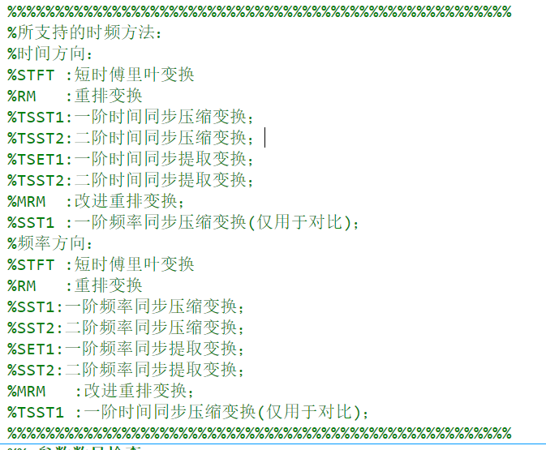
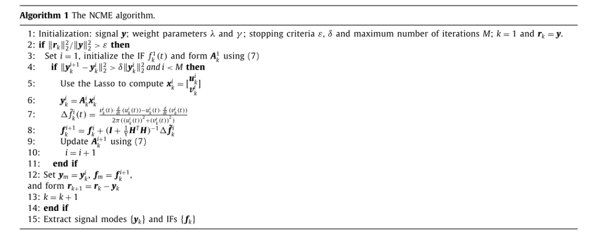
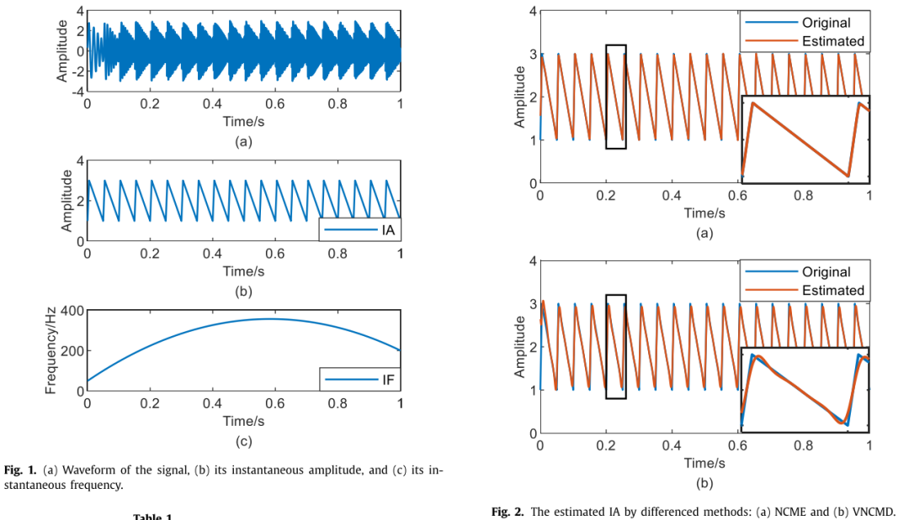
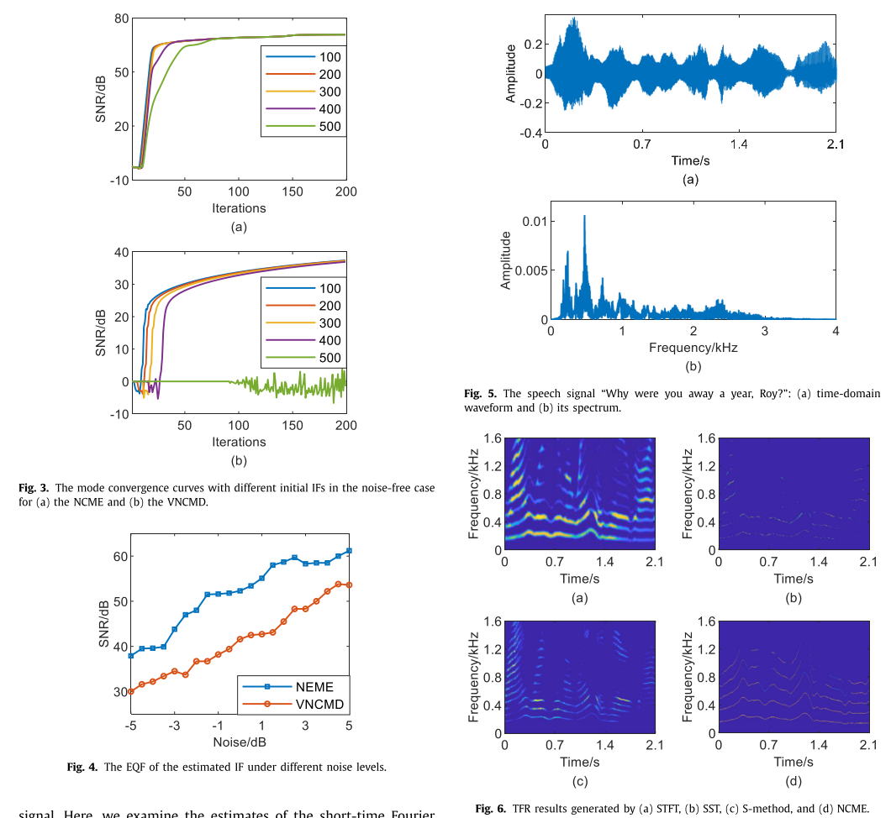
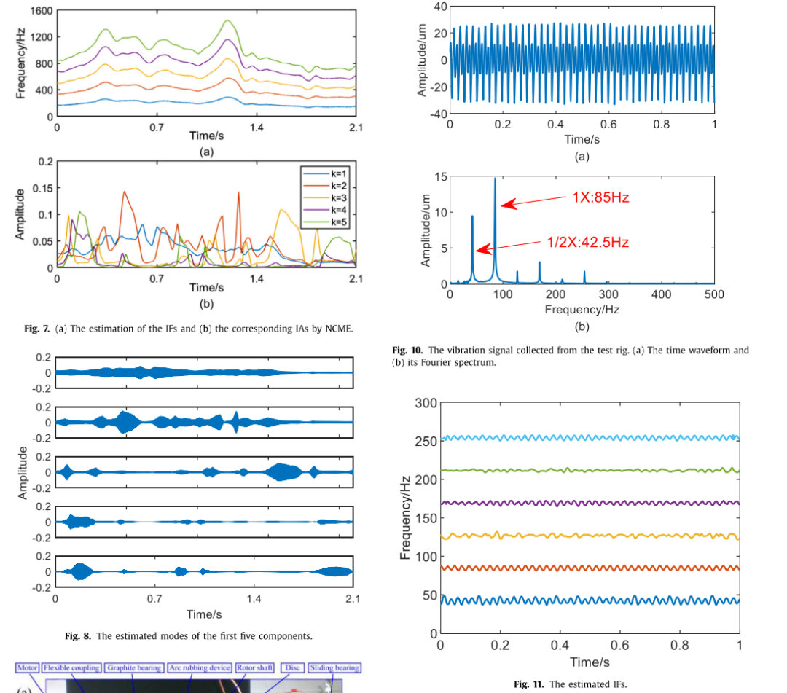
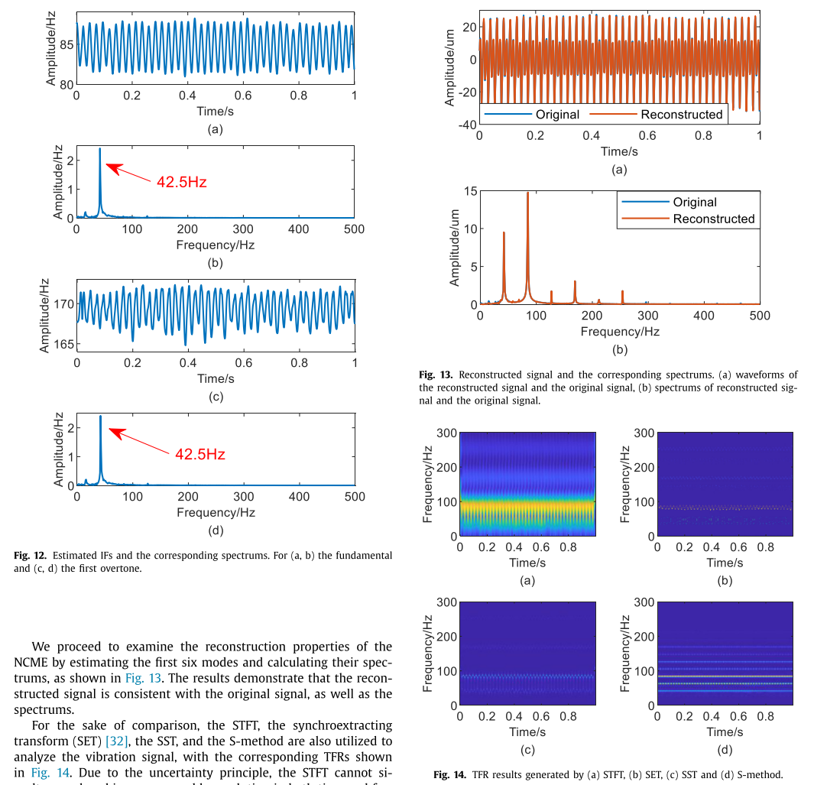
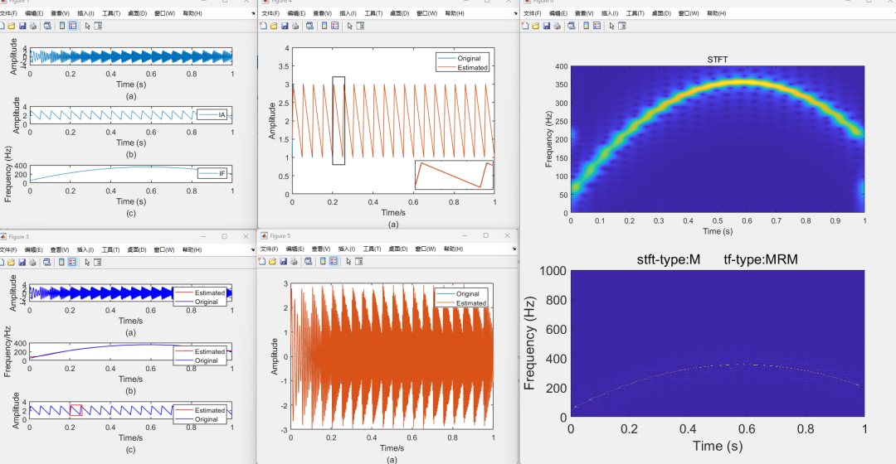

# 10 Time-Frequency Analysis: Using Sparseness Estimation to Detect Nonlinear Chirp Modes [with MATLAB Code]

Abstract: The task of decomposing nonlinear chirp modes using sparseness estimation is a challenging one. It is usually necessary to know the number of patterns that a signal contains in advance. This paper proposes a greedy nonlinear chirp mode estimation (NCME) technique. The technology uses the arctangent demodulation technique. The basis used for the decomposition of signals themselves. Formulate the obtained decomposition by considering the residual energy and smoothness of the instantaneous amplitude. Then a method based on alternating direction multipliers (alternating direction method of multipliers, (ADMM) estimator An efficient implementation of the estimator is provided. Numerical simulation and experimental data analysis verified the effectiveness and superiority of the proposed method.
Introduction: The task of decomposing nonlinear chirp modes using sparseness estimation is a challenging one. It is usually necessary to know the number of patterns that a signal contains in advance. This paper presents a greedy nonlinear chirp mode estimation (NCME) technique. The technology uses the arctangent demodulation technique. The basis used for the decomposition of signals themselves. Formulate the obtained decomposition by considering the residual energy and smoothness of instantaneous amplitude. Then a method based on alternating direction multipliers (alternating direction method of multipliers, (ADMM) estimator An efficient implementation of the estimator is provided.Numerical simulations and experimental data analysis validate the effectiveness and superiority of the proposed method. Time-frequency analysis plays a crucial role in analyzing and processing nonlinear signals that vary in frequency and amplitude over time [1,2]. Such nonlinear signals occur widely, for example, in human speech [3,4], vibration signals [5], and gravitational wave signals [6]. Given their importance, numerous methods have been proposed to estimate patterns that describe these signal forms in detail [7].
Utilizing sparseness estimation for nonlinear linear frequency modulation (LFFM) mode decomposition is a challenging task, typically requiring prior knowledge of the number of modes contained in the signal. In this work, we propose a greedy Nonlinear Linear Frequency Modulation Mode Estimation (NCME) technique that utilizes ArcTanGent demodulation to form the basis of the decomposition from the signal itself. The resulting decomposition is formed by considering the residual energy and smoothness of the instantaneous amplitude. We also derive an efficient implementation of the obtained estimator using the Alternating Direction Method of Multipliers (ADMM). Numerical simulations and experimental data analysis demonstrate the effectiveness and superiority of this method. Time-frequency analysis plays a crucial role in analyzing and processing nonlinear signals with varying frequencies and amplitudes over time [1,2].Non-linear signals exist in a wide range of applications, such as in human speech [3,4], vibration signals [5], and gravitational waves [6]. Given their importance, numerous methods have been proposed to estimate the detailed patterns that describe these signal forms [7]. For example, the Empirical Mode Decomposition (EMD), which is commonly used to decompose signals into a set of Intrinsic Mode Functions (IMFs) [8]. As a data-driven approach, EMD implements a recursive filtering process to estimate each mode individually. Due to its ability to distinguish different modes, this method has attracted attention and has been applied in many fields, including finance [9], mechanical engineering [10], and meteorology [11].
Inspired by EMD, Daubechies described a tool similar to EMD called Synchronous Sparse Transform (SST) for processing non-stationary signals [12]. Through the combination of continuous wavelet transform and reordering techniques, SST has a precise mathematical definition. SST has shown its powerful capabilities in a wide range of applications and several extensions have been developed to further enhance its performance [13]. Due to the original SST only yielding approximations of harmonic components, the use of higher-order phase functions as an extension is proposed [6, 14]. Currently, although computationally intensive, high-order SST theoretically can extend to any order of phase functions [6]. However, these SST-based methods provide instantaneous frequency (IF) information in the time-frequency plane in a subjective manner. To extract accurate values of IF, further steps are required.
Extensive efforts have been focused on estimating patterns that well describe the use of spectral lines. For example, Gills proposed the empirical wavelet transform (EWT), which decomposes the signal into subbands by constructing an adaptive wavelet basis [15]. To perform spectral segmentation, this method first determines the spectral peaks of each pattern. On this basis, corresponding wavelet filters are established to restore each pattern. However, EWT relies heavily on the peak detection algorithm used, making it difficult to separate closely spaced patterns. Later, Dragomiretskiy et al. [16] introduced the Variational Mode Decomposition (VMD), which uses a recursive algorithm to restore each pattern. Since VMD considers an optimized joint algorithm to estimate all patterns, it can produce more accurate results than EWT for dense patterns. However, EWT and VMD cannot recover broadband patterns with overlapping frequency ranges.
Over the past decade, the use of sparse reconstruction models has seen explosive applications in multiple fields of signal processing and machine learning. In many of these fields, the application of sparse models has been proven to be applicable to time-frequency analysis and source separation [17]. In [18], a sparse semiparametric method was proposed that allows for the estimation of the sum of chirps without assuming prior knowledge of the number of modes in the signal. This method approximates nonlinear chirps by dividing the signal into short intervals, then assumes that these short intervals are stationary or well modeled as containing linear chirps. In [19], the algorithm was further developed to estimate linear frequency modulated signals with time-varying amplitudes. As another alternative, intrinsic chirp component decomposition was proposed to handle general chirp signals [20]. Typically, these methods require dictionaries containing sets of candidate modes considered.
This paper proposes a Nonlinear Chirp Mode Estimation (NCME) method for modeling most of the signal containing multiple amplitude and frequency time-varying components. The method employs a sparse model, explicitly enhancing the smoothness of estimated parameters one by one, extracting modes. The estimator forms in an iterative manner in a recursive fashion, thus not requiring prior knowledge about the number of modes. Moreover, NCME can directly estimate the instantaneous amplitude (IA) and Intermediate Frequency (IF) of the signal, which is accomplished without segmenting the signal into short intervals. Simulation data and real flight data have demonstrated the effectiveness of this method. Then, an efficient algorithm based on the Alternating Direction Method of Multipliers (ADMM) was designed. The rest of the paper is organized as follows:
In the next section, NCME is presented together with the assumed signal model, including an introduced efficient implementation. Section 3 compares and validates the proposed method through analyzing a simulated signal and two real signals. Finally, conclusions are presented in Section 4.
Algorithm Flowchart
Figures in the article
MATLABExample codeclc\nclear\nclose all\n% simulated signal\nSampFreq = 2000;\nt = 0:1/SampFreq:1;\na1 = sawtooth(2*pi*20*t,0.1)+2;\nSig = a1.*cos(2*pi*(0.8+50*t + 525*t.^2 -300*t.^3));\nIF = 50 + 1050*t - 900*t.^2;\n​\n%% Original signal\nfsize = 12;\nfigure;\nsubplot(3,1,1)\nplot(t,Sig);\nxlabel({'Time (s)','(a)'});\nylabel('Amplitude');\nylim([-4 4]);\nset(gca,'fontsize',fsize,'linewidth',1)\n​\nsubplot(3,1,2)\nplot(t,a1);\nxlabel({'Time (s)','(b)'});\nylabel('Amplitude');\nylim([0 4]);\nlegend('IA');\nset(gca,'fontsize',fsize,'linewidth',1)\n​\nsubplot(3,1,3)\nplot(t,IF);\nxlabel({'Time (s)','(c)'});\nylabel('Frequency (Hz)');\nylim([0 400]);\nlegend('IF');\nset(gca,'fontsize',fsize,'linewidth',1)\n​\n%% Time-frequency representation\n​\n% Input parameters\nstft_type ='M';\ntf_type ='MRM';\ndirection = 'F';\ngamma = 0.001;\ns = 0.02;\ntradeoff = 0.009;\ndelta = 60;\n​\n% Calculate TFR\n[Wx,TFx,Ifreq,GD,Rep,Chirprate,q,t,f] = TFM(Sig,SampFreq,s,stft_type,tf_type,gamma);\n%TFR drawing\nfigure\nsubplot(2,1,1)\nimagesc(t,f,abs(Wx'));\naxis xy\nxlabel('Time (s)','FontSize',12);\nylabel('Frequency (Hz)','FontSize',12);\nylim([0 400]);\ntitle('STFT');\nset(gca,'FontSize',12);\nsubplot(2,1,2)\nimagesc(t,f,abs(TFx'));\naxis xy\nxlabel('Time (s)','FontSize',20);\nylabel('Frequency (Hz)','FontSize',20);\ntitle(['stft-type:',stft_type,'      tf-type:',tf_type]);\nset(gca,'FontSize',20);\n%% parameter setting\niniIF = 300*ones(1,length(t));% initial guess for the IFs for the three signal modes\nbeta = 1e-6; % this parameter can be smaller which will be helpful for the convergence, but it may cannot properly track fast varying IFs\ntol = 1e-8;%\nlambda =5e-4;\n% tic\n[IFmset1,IA1,smset1] = NCME(Sig,SampFreq,iniIF,lambda,beta,tol);\n% toc\n \n    %% estimated IF,IA,S\n    figure;\n    subplot(3,1,1)\n    plot(t,smset1(1,:,end),'r','linewidth',1)  % estimated mode\n    hold on;\n    plot(t,Sig,'b','linewidth',1);\n    xlabel({'Time/s','(a)'});\n    ylabel('Amplitude');\n    ylim([-4 4]);\n   set(gca,'fontsize',fsize,'linewidth',1)\n   legend('Estimated','Original');\n    \n    subplot(3,1,2)\n    plot(t,IFmset1(:,:,end),'r','linewidth',1); % finally estimated IFs\n    hold on\n    plot(t,IF,'b','linewidth',1);\n    xlabel({'Time/s','(b)'});\n    ylabel('Frequency/Hz');\n    ylim([0 400]);\n    set(gca,'fontsize',fsize,'linewidth',1);\n    legend('Estimated','Original');\n       \n       x1=0.2;\n       y1=0.8;\n       x2=0.26;\n       y2=3.2;\n     subplot(3,1,3)\n     plot(t,IA1,'r','linewidth',1);\n     hold on;\n     plot(t,a1,'b','linewidth',1); \n    xlabel({'Time/s','(c)'});\n    ylabel('Amplitude');\n    ylim([0 4]);\n    rectangle('Position',[x1 y1 x2-x1 y2-y1],'EdgeColor','r','Linewidth',1);\n    legend('Estimated','Original');\n    set(gca,'fontsize',fsize,'linewidth',1)\n    \n% Set the left bottom corner of the axes to be 8% of the window width, and 10% below the window's lower edge.\n%                                            % The entire width of the coordinate axis occupies 85%, and the height occupies 85%. A small box is thus created.\n%      axis(h1);\n%      plot(t,IA1,'r','linewidth',1);\n%      hold on;\n%      plot(t,a1,'b','linewidth',1); \n%      xlim([x1 x2]);ylim([y1 y2]);\n%      set(gca,'xticklabel',[]);set(gca,'yticklabel',[]);\n    %% Estimated Amplitude Estimated Amplitude\n     figure;\n%    set(gcf,'Position',[50 50 560 840]);\n    plot(t,a1,'linewidth',1); \n     hold on;\n     plot(t,IA1,'linewidth',1);\n    xlabel({'Time/s','(a)'});\n    ylabel('Amplitude');\n    ylim([0 4]);\n    rectangle('Position',[x1 y1 x2-x1 y2-y1],'EdgeColor','k','Linewidth',1);\n    legend('Original','Estimated');\n    set(gca,'fontsize',fsize,'linewidth',1)\n    \n     h1=axes('position',[0.60 0.2 0.3 0.15]);% Make the left bottom corner of the coordinate axis 8% of the width of the window, and 10% below the top\n                                             %The entire width of the coordinate axis accounts for 85%, and the height accounts for 85%. A small box is thus created.\n     axis(h1);\n     plot(t,a1,'linewidth',1.5); \n     hold on;\n     plot(t,IA1,'linewidth',1.5);\n     xlim([x1 x2]);ylim([y1 y2]);\n     set(gca,'xticklabel',[]);set(gca,'yticklabel',[]);\n     set(gca,'fontsize',fsize,'linewidth',1)\n    \n    %% Reconstructed signal\n    figure;\n    plot(t,Sig,'linewidth',1); \n    hold on;\n    plot(t,smset1(1,:,end),'linewidth',1);\n    xlabel({'Time/s','(a)'});\n    ylabel('Amplitude');\n    ylim([-3 3]);\n    legend('Original','Estimated');\n    set(gca,'fontsize',fsize,'linewidth',1)\n    \n%% Time-frequency representation\n​\n% Input parameters\nstft_type ='M';\ntf_type ='MRM';\ndirection = 'F';\ngamma = 0.001;\ns = 0.02;\ntradeoff = 0.009;\ndelta = 60;\n​\n% Calculate TFR\n[Wx,TFx,Ifreq,GD,Rep,Chirprate,q,t,f] = TFM(smset1(1,:,end),SampFreq,s,stft_type,tf_type,gamma);\n%TFR drawing\nfigure\nsubplot(2,1,1)\nimagesc(t,f,abs(Wx'));\naxis xy\nxlabel('Time (s)','FontSize',12);\nylabel('Frequency (Hz)','FontSize',12);\nylim([0 400]);\ntitle('STFT');\nset(gca,'FontSize',12);\nsubplot(2,1,2)\nimagesc(t,f,abs(TFx'));\naxis xy\nxlabel('Time (s)','FontSize',20);\nylabel('Frequency (Hz)','FontSize',20);\ntitle(['stft-type:',stft_type,'      tf-type:',tf_type]);\nset(gca,'FontSize',20);\n%% Evaluation factors\nSNR(a1,IA1)\nSNR(IF,IFmset1(:,:,end))\nSNR(Sig,smset1(1,:,end))\n  

## Images

<!-- PAYMENT_BLOCK -->

## Get this dataset

- Payment link (Stripe): [Buy now](https://buy.stripe.com/3cs8yP7sY87d0vu9AB)
- Payment QR code: 

<!-- /PAYMENT_BLOCK -->
